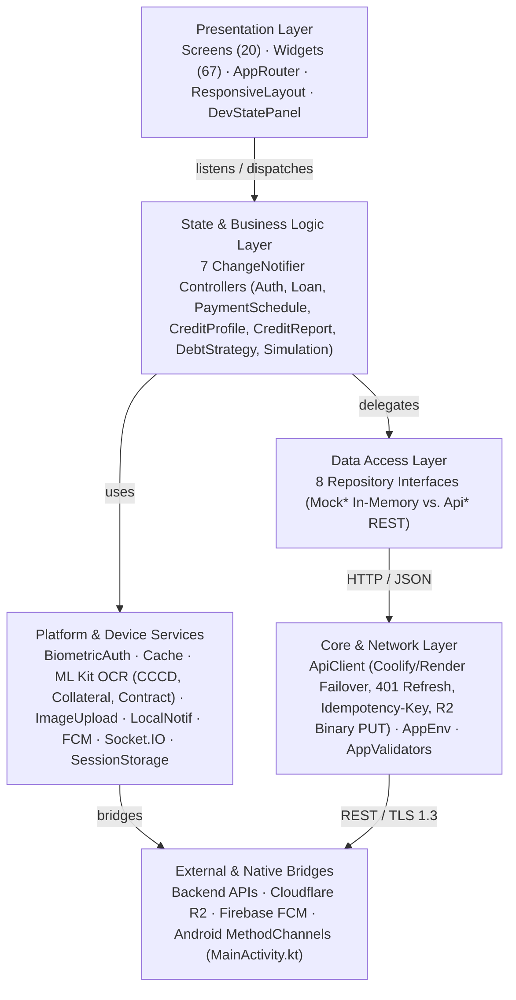

# FinCredit — Personal Debt Amortization & Credit Health Management


> **Official Project Title:** *Ứng dụng Flutter quản lý phân kỳ trả nợ và báo cáo sức khỏe tín dụng cá nhân*
>
> **Package Name:** `my_first_app` (`v1.0.0+1`) · **Dart SDK:** `^3.12.2` · **UI Framework:** Flutter (Material 3)

FinCredit is a production-oriented, cross-platform Flutter mobile application engineered for **personal loan portfolio management, installment amortization tracking, AI-assisted document OCR & eKYC verification, debt payoff optimization (Snowball & Avalanche), what-if repayment simulation, and periodic personal credit health reporting** tailored to Vietnamese banking standards.

### Backend Repositories
The FinCredit backend API is maintained across two repositories:
- **Primary Backend Repository (GitLab):** https://gitlab.com/iloveflo/fincredit-api.git
- **Mirror / Mobile Programming API Repository (GitHub):** https://github.com/iloveflo/Mobile_programming_api.git

---

## Table of Contents

1. [Key Features & Functional Modules](#key-features--functional-modules)
2. [System Architecture & Design Patterns](#system-architecture--design-patterns)
3. [Network Resilience, Failover & Security](#network-resilience-failover--security)
4. [Real-Time Sync, Push Notifications & Native Bridges](#real-time-sync-push-notifications--native-bridges)
5. [Financial Mathematics & Domain Rules](#financial-mathematics--domain-rules)
6. [UI/UX Design System, Routing & Responsive Layout](#uiux-design-system-routing--responsive-layout)
7. [Complete Project Structure](#complete-project-structure)
8. [Tech Stack & Dependencies](#tech-stack--dependencies)
9. [Environment Configuration & REST API Surface](#environment-configuration--rest-api-surface)
10. [Getting Started & Build Instructions](#getting-started--build-instructions)
11. [Platform-Specific Configurations](#platform-specific-configurations)
12. [Testing & Quality Assurance](#testing--quality-assurance)
13. [CI/CD Pipeline & Release Workflow](#cicd-pipeline--release-workflow)

---

## Key Features & Functional Modules

### 1. Authentication, 2FA & Session Security
- **Multi-Identifier Login:** Authenticate via Email, Vietnamese phone number, or CIC identifier with "Remember Me" persistence (`auth_session.json`).
- **Two-Factor OTP Verification (`OtpFlow`):** Supports 3 distinct flows (`register`, `forgotPassword`, `loginDevice` for unrecognized devices) with a 105-second countdown timer, up to 3 resends per session, and 5-attempt lockout protection.
- **Account Lockout & Password Management:** 15-minute lockout on repeated failures (`AccountLockedException`), real-time `PasswordStrengthMeter` (4-tier evaluation), forgot-password reset flow (`ResetSuccessDialog`), and authenticated password change (revoking other sessions).
- **Biometric & Auto-Lock:** Android fingerprint authentication (`local_auth` via `BiometricAuthService`) bound to persisted credentials (`biometric_binding.json`), plus a non-dismissible **5-minute inactivity Auto-Lock** guard in `MainShellScreen`.
- **Active Session Management:** View active device sessions (`SessionModel`) with platform/IP/location metadata and remotely revoke individual sessions.

### 2. Home Financial Cockpit (`HomeScreen`)
- **9-Section Executive Dashboard:**
  1. `SliverAppBar` with time-of-day greeting, eKYC verification badge, unread notification bell, and Customer Support modal (`1900 6868` / `support@fincredit.vn`).
  2. `HomeHeroCard` with privacy balance hide/show toggle (`ValueNotifier<bool>`), repayment progress bar, CIC score chip, and quick CTAs (`DebtPlanningSheet`, `CashflowDetailSheet`).
  3. `HomeQuickActionGrid` (8 shortcuts: Add Loan, Schedule, CIC Health, OCR Scanner, Quick Interest Calculator, Simulation, Debt Strategy, DTI Report).
  4. `HomeUrgentDueBanner` highlighting the next active/overdue installment with one-tap navigation to payment.
  5. `HomeActiveLoansSlider` horizontal carousel of active loans.
  6. `HomeDtiGaugeCard` 4-tier Debt-to-Income visual gauge opening `DtiReportModal`.
  7. `HomeCashflowProjectionCard` 6-month income vs. debt outflow projection chart.
  8. `HomeEducationCarousel` financial literacy articles (`ArticleDetailModal`).
  9. `HomeSecurityFooter` (`FinCredit Security Standard`, `v1.0.0-beta`).

### 3. Loan Portfolio, Collateral & Vietnamese Banking Rules (`LoanListScreen`, `LoanDetailScreen`, `LoanFormScreen`)
- **Portfolio Overview:** Aggregated remaining principal, original principal, paid ratio, monthly commitment, and active/overdue counts (`PortfolioSummaryCard`).
- **Filtering & Search:** Filter by `LoanStatus` (`all`, `active`, `closed`, `overdue`), lender name, and keyword search across loan name, code (`HD-XXXX`), and lender without mutating portfolio-level totals.
- **Loan Creation & Editing:**
  - Supports **Create**, **Edit** (locks bank, loan type, and start date; locks principal, tenor, and interest method if payments already exist), and **OCR Prefill**.
  - Enforces **Vietnamese banking unsecured credit rules** (minimum 3,000,000 VND monthly income, max 3 active unsecured loans, 12x income cap up to 500,000,000 VND, and projected DTI ≤ 60%).
  - Auto-populates benchmark interest rates by bank (`LoanModel.standardBanks`) and loan category (`MORTGAGE`, `CAR`, `CONSUMER`, `CREDIT_CARD`, `OTHER`).
  - Live `MonthlyEstimateCard` comparing `REDUCING_BALANCE` vs. `FLAT` amortization.
- **Loan Lifecycle Actions:** Record installment payments, view full repayment schedule (`LoanRepaymentScheduleSheet`), execute early payoff (`EarlyPayoffModal`), manage attached R2 contract documents (`LoanContractDocumentsSection`), or hard-delete loans with zero paid installments (`canHardDelete`).
- **Collateral & LTV Tracking:** Attach collaterals (`REAL_ESTATE`, `VEHICLE`, `SAVINGS`, `OTHER`) with asset-type valuation bounds, shared-collateral debt capacity tracking, and portfolio/loan-level `LtvIndicatorBar`.

### 4. On-Device AI/ML Kit OCR & eKYC Verification
All OCR and identity verification parsing runs **100% on-device** using `google_mlkit_barcode_scanning` and `google_mlkit_text_recognition`:
- **Chip-Based CCCD eKYC (`CccdScannerService` & `EkycVerificationSheet`):**
  - Front side: QR code payload parsing with Latin OCR fallback.
  - Back side: 3-line TD1 ICAO 9303 MRZ parsing.
  - Validates expiration dates and cross-checks front vs. back identity numbers, names (diacritic-normalized), and dates of birth before uploading verified images to Cloudflare R2.
- **Collateral Document Verification (`CollateralScannerService`):**
  - Verifies legal documents for Savings Passbooks, Vehicle Registrations (Cavet), and Real Estate Certificates (Sổ đỏ/Sổ hồng).
  - Checks document-type keywords, rejects settled/expired/invalid keywords, matches 12-digit CCCD & owner name against the user's eKYC profile, and extracts valuation & certificate/plate/plot numbers.
- **Loan Contract & Credit Card Statement OCR (`LoanContractScannerService` & `LoanCollateralOcrScreen`):**
  - Extracts lender, loan type, contract number, principal amount, interest rate (normalizing annual/monthly rates), tenor (converting years to months), start date, and collateral hints with a confidence score, then pre-fills `LoanFormScreen`.

### 5. Debt Amortization & Payment Schedules (`PaymentScheduleScreen`)
- **Paginated Schedule Feed:** Infinite-scroll `ListView` (`pageSize = 20`) with status chips (`ALL`, `UPCOMING`, `OVERDUE`, `PAID`) and period filters (`ALL`, `1M`, `3M`, `6M`, `1Y`).
- **Payment Recording & Sync:** One-tap `markAsPaid` with double-tap idempotency guard (`_isPaying`), automatic recalculation of `LoanController` and `CreditProfileController`, and manual schedule/notification resync.
- **Notification Center & Preferences:** Manage in-app notifications (`NotificationListSheet`) and configure reminder lead days (`1`, `3`, `5`, `7` days) and Push/Email/Balance-Fluctuation/Monthly-Statement toggles (`NotificationPreferenceSheet`).

### 6. Personal Credit Health & Periodic Credit Reports (`CreditHealthScreen`, `CreditReportListScreen`, `CreditReportDetailScreen`)
- **Credit Health Dashboard:** Interactive `CreditScoreGauge` (300–850 scale), risk-level classification, 5 `CreditMetricCard`s (DTI, LTV, Credit Utilization, On-Time Payment Rate, Active Loan Count) with educational `CreditFactorSheet` modals, and server-side recalculation.
- **Exception-Code Resilience:** Explicit UI handling for `EX-01` (no loans), `EX-02` (incomplete metric data with deep-links to fix), `EX-03` (403 unauthorized), `EX-04` (invalid/database error), and `EX-05` (server failure).
- **Periodic Credit Reports:** Generate monthly/quarterly snapshots (`GenerateReportDialog` preventing duplicate or future periods), visualize historical score & debt trends (`CreditReportTrendCard` with score/debt deltas), inspect detailed snapshots, and delete reports.

### 7. Debt Payoff Optimization & What-If Simulation (`DebtStrategyScreen`, `SimulationScreen`)
- **Debt Strategy Optimizer:** Compares **Debt Avalanche** (highest interest rate first) vs. **Debt Snowball** (smallest balance first) with an adjustable extra monthly payment slider, priority queue (`DebtPriorityList`), side-by-side comparison (`DebtComparisonView`), and persistent strategy activation (`ACTIVE`/`INACTIVE`).
- **4-Scenario What-If Simulator:**
  1. `extraPayment`: Lump-sum principal prepayment.
  2. `changePayment`: Adjusted monthly installment amount.
  3. `changeInterestRate`: Refinanced annual interest rate.
  4. `earlyPayoff`: Full early settlement at a chosen target month including penalty fee rate.
  - Saves reference scenarios (`SIMULATION_REFERENCE`) to `SimulationHistorySheet` for later re-application.

### 8. Profile, PDF Export & App Settings (`ProfileScreen`, `AppSettingsScreen`)
- **Financial Dossier & PDF Export:** Complete KYC identity card, employment/income profile, avatar upload to Cloudflare R2, and one-tap **Financial Capability Profile PDF** download & native viewer (`FinancialProfilePdfHelper`).
- **Settings & Cache Hygiene:** Security score card (`95` with biometrics enabled / `75` without), cache size inspection & safe cleanup (`CacheService` preserving `fincredit_storage` auth tokens), active session revocation, and clean logout.

---

## System Architecture & Design Patterns

FinCredit follows a **layered, dependency-injected architecture** built around `get_it` (`lib/service_locator.dart`), `ChangeNotifier` controllers, and dual-implementation repositories (`Mock*` vs. `Api*`).



### Key Architectural Highlights
- **Runtime Mode Switching:** `setupServiceLocator({bool? isMock})` and `switchServiceLocatorMode({required bool isMock})` allow seamless swapping between `Mock*` and `Api*` repositories (auto-enabling mock mode when `FLUTTER_TEST` is detected).
- **Profile Completion Gatekeeping:** `ProfileCompletionScaffold` wraps `HomeScreen`, `LoanListScreen`, `PaymentScheduleScreen`, `CreditHealthScreen`, and `LoanFormScreen` (create mode). Until eKYC verification, 12-digit CCCD, full name, DOB, address, phone, and positive monthly income are complete, users are guided directly to `ProfileScreen`.
- **Cross-Controller Synchronization:** Mutating a loan, collateral, or installment payment automatically triggers downstream refreshes on `PaymentScheduleController`, `LoanController`, and `CreditProfileController`.

> [!IMPORTANT]
> Core financial screens (`HomeScreen`, `LoanListScreen`, `PaymentScheduleScreen`, `CreditHealthScreen`, and `LoanFormScreen` in create mode) enforce **Profile & eKYC Gatekeeping** via `ProfileCompletionScaffold`. Users must complete eKYC CCCD verification and declare a valid monthly income before creating loans or viewing credit health metrics.

---

## Network Resilience, Failover & Security

### Dual-Server Failover & Circuit Breaker (`ApiClient` & `AppEnv`)
In production (`ENV=prod` without a custom `BASE_URL`), `ApiClient` supports automatic bidirectional failover between:
- **Primary Server (Coolify):** `https://fincredit.binha10k56.id.vn/api/v1`
- **Fallback Server (Render):** `https://fincredit-api-gjiz.onrender.com/api/v1`

1. **Startup & Login Health Probe (`ensureHealthyEndpoint`):** Probes `/health` on primary (4s timeout) and fallback (15s timeout), automatically preferring primary when recovered.
2. **Instant Failover:** Auth endpoints (`/auth/login`, `/auth/register`, `/auth/check-session`) immediately probe the peer `/health` endpoint on `SocketException`, `TimeoutException`, `HandshakeException`, or HTTP `502`/`503`/`504`, switch active `baseUrl`, and retry transparently.
3. **Threshold Circuit Breaker:** For general endpoints, `serverFailureThreshold` (default `3` consecutive server-down errors) triggers a peer `/health` check, switches endpoints, disconnects `RealtimeService`, logs out, and navigates to `/login` via `onServerFailover`.

### Single-Flight 401 Token Refresh & Idempotency
- **401 Interceptor:** Non-auth endpoints receiving HTTP `401` share a single in-flight `_refreshFuture` (`POST /api/auth/refresh-token`), preventing concurrent refresh storms and retrying the original request upon success.
- **Automatic `Idempotency-Key`:** Every `POST`, `PUT`, `PATCH`, and `DELETE` request automatically attaches a cryptographically random `Idempotency-Key` (`fc-<timestamp>-<random>`) preserved across 401 retries.

### Local Storage & Security Controls
- **`SessionStorageService`:** Uses synchronous file I/O under `Directory.systemTemp/fincredit_storage` (for deterministic behavior in `FakeAsync` tests) to store `auth_session.json`, `biometric_binding.json` (retained across logout for quick fingerprint re-login), and `device_id.txt`.
- **URL Prefix Normalization:** `ApiClient._buildUri` automatically strips duplicate `/api` or `/api/v1` prefixes so repositories with or without `/api` paths resolve cleanly.

---

## Real-Time Sync, Push Notifications & Native Bridges

- **Socket.IO Real-Time Client (`RealtimeService`):** Connects to the API origin with Bearer token (`websocket` + `polling`), listens for `credit_health_update` (debounced at `300ms` to batch-refresh `LoanController`, `PaymentScheduleController`, and `CreditProfileController`), `notification`, and `session_revoked` (forces immediate logout and redirect to `/login`).
- **Firebase Cloud Messaging (`PushNotificationService`):** Initializes `firebase_core` and `firebase_messaging`, handles background messages via top-level `@pragma('vm:entry-point') firebaseMessagingBackgroundHandler`, forwards foreground messages to `LocalNotificationService`, and syncs FCM tokens via `POST`/`DELETE /api/user/fcm-token`.
- **Native Android `MethodChannel` Bridges (`MainActivity.kt` extending `FlutterFragmentActivity`):**
  - `fincredit/notifications`: Creates high-importance channel `fincredit_reminders`, handles Android 13+ `POST_NOTIFICATIONS` runtime permissions, deduplicates notifications via `SharedPreferences` (`fincredit_notifs`), and routes cold-start/warm-start taps (`tabIndex`, `scheduleId`) into `MainShellScreen`.
  - `fincredit/launcher`: Implements `openUrl` (`ACTION_VIEW`) and `saveAndOpenPdf` (writes PDFs to `MediaStore.Downloads` on Android Q+ or `DIRECTORY_DOWNLOADS` on legacy Android and launches a PDF viewer).
- **Cloudflare R2 Direct Storage (`ApiStorageRepository` & `ImageUploadService`):**
  1. Requests presigned `PUT` URL (`POST /api/storage/presigned-url`).
  2. Streams binary payload directly to R2 (`ApiClient.uploadBinary`, 5-minute timeout).
  3. Confirms upload (`POST /api/storage/confirm-upload`).
  - View URLs (`GET /api/storage/view-url`) are cached in RAM per auth token with `expiresIn - buffer` TTL and single-flight request deduplication (`_inFlightViewUrls`).

---

## Financial Mathematics & Domain Rules

### 1. Loan Amortization (`LoanModel`, `DebtStrategyController`, `SimulationController`)
- **Reducing Balance Annuity Formula:**

```math
M = \begin{cases} \dfrac{P \cdot r \cdot (1+r)^n}{(1+r)^n - 1} & \text{if } r > 0 \\ \dfrac{P}{n} & \text{if } r = 0 \end{cases}
```

  where $P$ is outstanding/principal balance, $r = \frac{\text{annualRate}}{12}$, and $n$ is remaining/total tenor in months.
- **Flat Interest Formula:** $M = \frac{P}{n} + P \cdot r$.
- **Payoff Months with Accelerated Payment ($M_{\text{eff}} > P \cdot r$):**

```math
n_{\text{new}} = \left\lceil \frac{-\ln\left(1 - \frac{P \cdot r}{M_{\text{eff}}}\right)}{\ln(1 + r)} \right\rceil
```

### 2. Debt Optimization Multipliers (`DebtStrategyController`)
- **Avalanche** sorts active loans descending by `interestRate`; **Snowball** sorts ascending by `outstandingAmount`.
- When optimizing multiple loans (`validLoans.length > 1`), rollover compounding is modeled with adjustment factors `0.92` (Avalanche) and `0.97` (Snowball) on total optimized interest.

### 3. Collateral LTV & Unsecured Credit Rules (`CollateralModel`, `LoanModel`)
- **Max LTV Caps by Asset Type:**
  - `REAL_ESTATE`: **80%** (`0.80`) — valuation bounds `100M – 100B VND`
  - `VEHICLE`: **70%** (`0.70`) — valuation bounds `20M – 20B VND`
  - `SAVINGS`: **95%** (`0.95`) — valuation bounds `5M – 100B VND`
  - `OTHER`: **70%** (`0.70`) — valuation bounds `5M – 50B VND`
- **Unsecured Loan Eligibility:** Requires monthly income $\ge 3,000,000\text{ VND}$, max $3$ active unsecured loans, credit limit $\min(\text{income} \times 12,\ 500,000,000\text{ VND})$, and projected $\text{DTI} \le 60\%$.
- **Benchmark Annual Interest Rates (`LoanModel.benchmarkRates`):** Pre-configured for `Vietcombank`, `Techcombank`, `MBBank`, `BIDV`, `VPBank`, `VietinBank`, `ACB`, `VIB`, `Sacombank`, `TPBank`, `FE Credit`, `Home Credit`, and `Khác` across all 5 loan categories.

---

## UI/UX Design System, Routing & Responsive Layout

### Color Palette (`AppColors` in `lib/widgets/common/app_colors.dart`)
| Token | Hex | Usage |
|---|---|---|
| `primary` | `#0D47A1` | Royal Deep Blue — primary CTAs, active tabs, brand headers |
| `primaryLight` | `#1976D2` | Electric Blue — secondary accents, links |
| `primarySoft` | `#EBF3FC` | Soft Ice Blue — subtle badges and chip backgrounds |
| `surface` | `#FFFFFF` | Cards, sheets, and AppBars |
| `background` | `#F8FAFD` | Scaffold canvas |
| `border` | `#E2E8F0` | Card & input borders |
| `textPrimary` | `#0F172A` | Primary headings & body text |
| `textSecondary` | `#64748B` | Captions & metadata |
| `error` / `success` / `warning` | `#DC2626` / `#16A34A` / `#F59E0B` | Semantic status indicators |

### Responsive System (`lib/layout/responsive_layout.dart`)
- **Breakpoints:** `compactMaxWidth = 360.0`, `phoneMaxWidth = 600.0`, `contentMaxWidth = 600.0`.
- **Text Scaling:** `ResponsiveTextScaler.clamp(context)` clamps system font scaling to `[0.9, 1.25]` globally in `FinCreditApp.builder`.
- **Adaptive Components:** `ResponsiveContentConstraint` (600dp max width), `ResponsiveTwoColumnGrid` (`IntrinsicHeight` 2-column grid collapsing to 1 column below `310dp`), and `ResponsiveBottomSheetBody` (`0.9` max height factor + `viewInsets.bottom` keyboard handling).

### Named Routes (`AppRouter` in `lib/routes/app_router.dart`)
| Route Constant | Path | Screen |
|---|---|---|
| `AppRouter.splash` | `/` | `SplashScreen` |
| `AppRouter.login` | `/login` | `LoginScreen` |
| `AppRouter.register` | `/register` | `RegisterScreen` |
| `AppRouter.otp` | `/otp` | `OtpVerificationScreen` |
| `AppRouter.resetPassword` | `/reset-password` | `ResetPasswordScreen` |
| `AppRouter.security` / `settings` | `/security`, `/settings` | `AppSettingsScreen` |
| `AppRouter.home` | `/home` | `MainShellScreen` (6-tab `IndexedStack` with scroll-aware `CustomBottomNavBar`) |
| `AppRouter.loans` | `/loans` | `LoanListScreen` |
| `AppRouter.loanDetail` | `/loans/detail` | `LoanDetailScreen` |
| `AppRouter.loanForm` | `/loans/form` | `LoanFormScreen` |
| `AppRouter.loanCollateralOcr` | `/loans/collateral-ocr` | `LoanCollateralOcrScreen` |
| `AppRouter.debtStrategy` | `/debt-strategy` | `DebtStrategyScreen` |
| `AppRouter.simulation` | `/simulation` | `SimulationScreen` |
| `AppRouter.creditReports` | `/credit-reports` | `CreditReportListScreen` |
| `AppRouter.creditReportDetail` | `/credit-reports/detail` | `CreditReportDetailScreen` |

---

## Complete Project Structure

```text
my_first_app/
├── .github/workflows/
│   ├── ci.yml                              # Format, analyze, test+coverage, debug APK
│   └── release.yml                         # Tag-triggered release APK & GitHub Release
├── docs/
│   └── CI_CD.md                            # CI/CD & branching strategy documentation
├── android/                                # Android Gradle (Kotlin), ProGuard, google-services.json, MainActivity.kt
├── ios/                                    # iOS Runner, Info.plist, SceneDelegate
├── web/                                    # PWA manifest.json, icons, index.html
├── linux/ · macos/ · windows/              # Desktop runner targets
├── assets/icon/                            # app_icon.png, ic_launcher_foreground.png, ic_launcher_round.png
├── lib/
│   ├── main.dart                           # Entry point (FCM init, GetIt setup, FinCreditApp)
│   ├── service_locator.dart                # GetIt DI registration & runtime Mock/API switcher
│   ├── core/
│   │   ├── config/app_env.dart             # --dart-define flags & Coolify/Render URLs
│   │   ├── network/api_client.dart         # HttpClient, failover, 401 refresh, Idempotency-Key, R2 binary PUT
│   │   └── utils/app_validators.dart       # 15 standardized Vietnamese/financial form validators
│   ├── layout/responsive_layout.dart       # Breakpoints, text scaler clamp, adaptive grids & sheets
│   ├── routes/app_router.dart              # Centralized named routes & argument extraction
│   ├── models/                             # 20 domain models (Loan, Collateral, CreditProfile, CreditReport, etc.)
│   ├── mock_data/                          # 15 mock datasets for offline/test execution
│   ├── repositories/
│   │   ├── interfaces/                     # 8 repository contracts + domain auth exceptions
│   │   ├── mock/                           # 8 in-memory mock repositories with error-simulation flags
│   │   └── remote/                         # 8 REST API repositories
│   ├── services/                           # 10 services (Biometric, Cache, CCCD/Collateral/Contract OCR, FCM, Socket.IO, etc.)
│   ├── controllers/                        # 7 ChangeNotifier controllers
│   ├── screens/                            # 20 screens across auth, home, loans, schedule, credit, credit_report, debt, simulation, profile, settings
│   └── widgets/                            # 67 reusable widgets & modals + barrel export widget.dart
└── test/                                   # 29 unit & widget test files (341 test cases)
```

---

## Tech Stack & Dependencies

Defined in `pubspec.yaml`:

| Package | Version | Purpose |
|---|---|---|
| `flutter` | SDK | Material 3 UI & core framework (`uses-material-design: true`) |
| `cupertino_icons` | `^1.0.8` | iOS-style iconography |
| `get_it` | `^9.2.1` | Service Locator dependency injection |
| `image_picker` | `^1.2.4` | Camera & gallery capture for OCR/eKYC/avatars |
| `google_mlkit_barcode_scanning` | `^0.13.0` | On-device QR code scanning (CCCD front) |
| `google_mlkit_text_recognition` | `^0.14.0` | On-device Latin OCR (CCCD MRZ, contracts, collaterals) |
| `local_auth` | `^2.3.0` | Native Android BiometricPrompt fingerprint auth |
| `socket_io_client` | `^3.0.2` | Real-time Socket.IO event synchronization |
| `firebase_core` | `^3.12.1` | Firebase initialization |
| `firebase_messaging` | `^15.2.4` | Firebase Cloud Messaging (push notifications) |
| `flutter_lints` | `^6.0.0` | Static analysis ruleset (`dev_dependencies`) |

---

## Environment Configuration & REST API Surface

### Build-Time Flags (`--dart-define` in `AppEnv`)
| Flag | Default | Description |
|---|---|---|
| `USE_MOCK` | `false` | `true` forces in-memory `Mock*` repositories; `false` uses `Api*` remote repositories |
| `ENV` | `prod` | `prod` uses Coolify primary + Render fallback; `dev` uses `http://10.0.2.2/api/v1` |
| `BASE_URL` | `""` | Overrides `primaryBaseUrl` and disables automatic Render fallback |

### REST API Endpoints Consumed by `Api*` Repositories
| Domain | Endpoints |
|---|---|
| **Auth & Session** | `GET /api/auth/session`, `POST /api/auth/login`, `POST /api/auth/register`, `POST /api/auth/verify-otp`, `POST /api/auth/resend-otp`, `POST /api/auth/refresh-token`, `POST /api/auth/reset-password`, `POST /api/auth/change-password`, `GET /api/auth/sessions`, `DELETE /api/auth/sessions/:id`, `POST /api/auth/logout` |
| **User, eKYC & Push** | `GET /api/user/profile`, `PUT /api/user/profile`, `PUT /api/user/security-settings`, `GET /api/user/financial-profile-pdf`, `POST /api/user/ekyc-verify`, `POST /api/user/fcm-token`, `DELETE /api/user/fcm-token` |
| **Loans & Collaterals** | `GET /api/loans`, `GET /api/loans/:id`, `POST /api/loans`, `PUT /api/loans/:id`, `DELETE /api/loans/:id`, `POST /api/loans/ocr-scan`, `GET /api/loans/:id/documents`, `GET /api/collaterals`, `POST /api/collaterals`, `DELETE /api/collaterals/:id` |
| **Schedules & Notifications** | `GET /payment-schedules`, `GET /payment-schedules/:id`, `POST /payment-schedules/:id/pay`, `POST /payment-schedules/sync`, `GET /notifications/preference`, `PUT /notifications/preference`, `GET /notifications`, `DELETE /notifications/:id`, `DELETE /notifications` |
| **Credit Health & Reports** | `GET /credit-profile`, `POST /credit-profile/recalculate`, `GET /credit-reports`, `GET /credit-reports/:id`, `POST /credit-reports/generate`, `DELETE /credit-reports/:id` |
| **Debt Strategy & Simulation** | `GET /debt-strategies`, `GET /debt-strategies/active`, `POST /debt-strategies/apply`, `PATCH /debt-strategies/:id/cancel`, `GET /simulations`, `POST /simulations`, `DELETE /simulations/:id` |
| **Cloudflare R2 Storage** | `POST /api/storage/presigned-url`, `POST /api/storage/confirm-upload`, `GET /api/storage/view-url`, `GET /api/storage/files`, `DELETE /api/storage/file` |
| **Health Probe** | `GET /health` (origin root) |

---

## Getting Started & Build Instructions

### Prerequisites
- Flutter SDK (`stable` channel, Dart `^3.12.2`)
- Android Studio / JDK 17 (Android `minSdk 23`)
- Xcode (for iOS builds)

### Installation & Run Commands
```bash
# 1. Install dependencies
flutter pub get

# 2. Run against Production Backend (Coolify + Render fallback)
flutter run

# 3. Run in Offline Mock Mode (no backend required)
flutter run --dart-define=USE_MOCK=true

# 4. Run against Local Backend (Android Emulator -> 10.0.2.2)
flutter run --dart-define=ENV=dev

# 5. Run against a Custom Backend URL
flutter run --dart-define=BASE_URL=https://your-api-domain.com/api/v1
```

### Debug Developer Panel (`DevStatePanel`)

> [!NOTE]
> In `kDebugMode`, **double-tapping the FinCredit logo on `SplashScreen`** opens `DevStatePanel`, allowing QA/developers to simulate 7 auth states (`normal`, `loading`, `invalidCredentials`, `accountUnverified`, `accountLocked`, `networkError`, `sessionExpired`) without backend mutations. Running with `--dart-define=USE_MOCK=true` also bypasses live API calls using the 15 in-memory mock datasets.

### Building APK
```bash
# Debug APK
flutter build apk --debug --android-skip-build-dependency-validation

# Release APK
flutter build apk --release --android-skip-build-dependency-validation
```

---

## Platform-Specific Configurations

- **Android (`android/app/build.gradle.kts`, `AndroidManifest.xml`, `proguard-rules.pro`):**
  - `applicationId`: `com.example.my_first_app`, `minSdk`: `23`, Java/Kotlin `17`, `usesCleartextTraffic="true"`.
  - Permissions: `INTERNET`, `USE_BIOMETRIC`, `POST_NOTIFICATIONS`.
  - Firebase configured via `android/app/google-services.json` (`iloveflo-90e8e`) and default notification channel `fincredit_reminders`.
  - ProGuard rules preserve ML Kit text recognition & barcode scanning classes.

> [!WARNING]
> Android `release` builds in `android/app/build.gradle.kts` currently use `signingConfigs.getByName("debug")` for internal APK distribution. Before publishing to Google Play, configure a dedicated release keystore via GitHub Actions Secrets and build signed `.aab` bundles.
- **iOS (`ios/Runner/Info.plist`):**
  - App name `FinCredit`, `NSCameraUsageDescription` & `NSPhotoLibraryUsageDescription` configured, `NSAllowsArbitraryLoads = true`, `UIApplicationSceneManifest` enabled.
- **Web (`web/manifest.json`):**
  - Configured as a standalone PWA (`FinCredit - Quản Lý Tín Dụng Thông Minh`, theme `#0D47A1`) with standard and maskable icons (`192x192`, `512x512`).

---

## Testing & Quality Assurance

The project includes **29 test files** totaling **341 test cases** across unit, repository, service, controller, widget, and responsive layout suites:

- **Networking, Storage & Resilience:** `api_client_failover_test.dart` (7), `idempotency_guard_test.dart` (2), `remote_repositories_test.dart` (12), `storage_repository_test.dart` (4), `cache_service_test.dart` (5).
- **Auth, Security & Services:** `auth_repository_test.dart` (10), `auth_controller_test.dart` (14), `auth_ui_flow_test.dart` (4), `biometric_auth_service_test.dart` (5), `push_notification_service_test.dart` (4), `realtime_service_test.dart` (4), `app_validators_test.dart` (15).
- **On-Device OCR & eKYC:** `cccd_scanner_test.dart` (4), `collateral_scanner_test.dart` (6), `loan_contract_scanner_test.dart` (8).
- **Core Financial Domains:** `loan_controller_test.dart` (21), `loan_screen_test.dart` (6), `payment_schedule_test.dart` (19), `credit_profile_test.dart` (17), `credit_report_test.dart` (18), `debt_strategy_test.dart` (10), `simulation_test.dart` (15).
- **Screens, Shell & Edge Cases:** `home_screen_test.dart` (12), `main_shell_screen_test.dart` (6), `profile_screen_test.dart` (3), `app_settings_screen_test.dart` (4), `edge_cases_test.dart` (6), `widget_test.dart` (2).
- **Responsive Overflow Matrix:** `responsive_layout_test.dart` (98 tests verifying zero overflow across `320×568 @ 1.25x`, `390×844 @ 1.0x`, `768×1024 @ 1.15x`, `844×390 @ 1.0x`, and `568×320 @ 1.15x`).

### Running Checks Locally
```bash
dart format --output=none --set-exit-if-changed lib test
flutter analyze --fatal-infos
flutter test --coverage
```

---

## CI/CD Pipeline & Release Workflow

Documented in [`docs/CI_CD.md`](docs/CI_CD.md) and automated via GitHub Actions:

1. **Continuous Integration (`.github/workflows/ci.yml`):**
   - Triggers on PRs to `main` and pushes to `main` / `develop`.
   - **Job 1 (`quality-and-test`):** `flutter pub get` → `dart format` check → `flutter analyze --fatal-infos` → `flutter test --coverage` → uploads `coverage/lcov.info` artifact (14-day retention).
   - **Job 2 (`build-android`):** Runs after `quality-and-test`, sets up Java 17, builds `app-debug.apk`, and uploads it as an artifact (14-day retention).
2. **Continuous Delivery (`.github/workflows/release.yml`):**
   - Triggers on version tags `v*.*.*` or manual `workflow_dispatch`.
   - Re-runs `flutter analyze --fatal-infos` and `flutter test`, builds `FinCredit.apk` (`--release`), uploads the artifact, and publishes a GitHub Release with auto-generated release notes.
3. **Production Roadmap:** Before Google Play submission, replace debug signing with a production release keystore stored in GitHub Actions Secrets, build `.aab` bundles, and add a Google Play Internal Testing deployment step.
